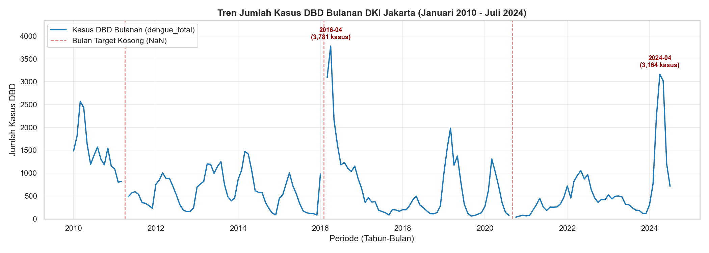
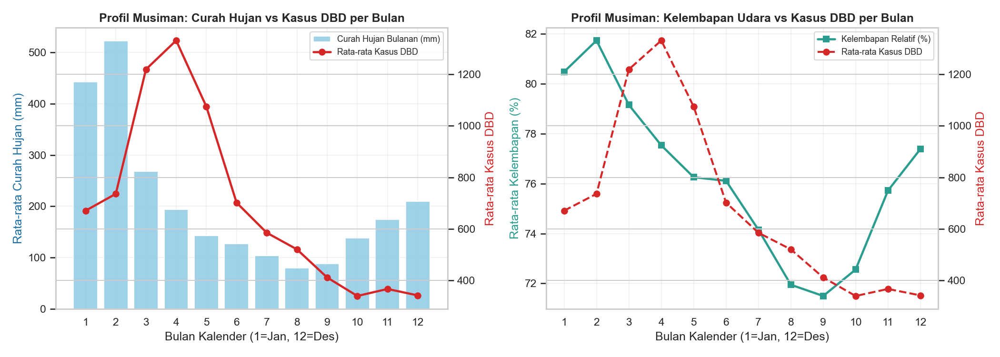
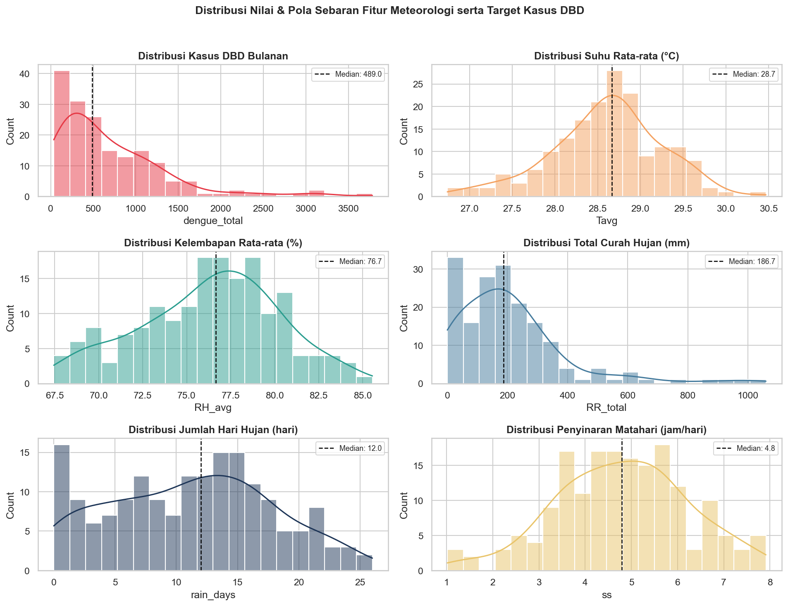
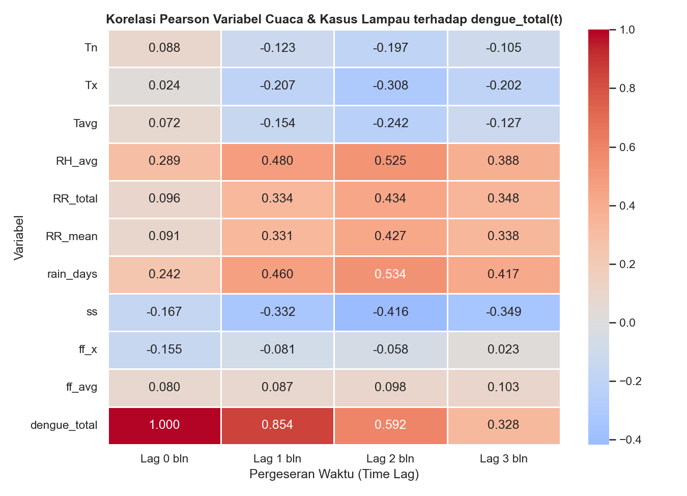
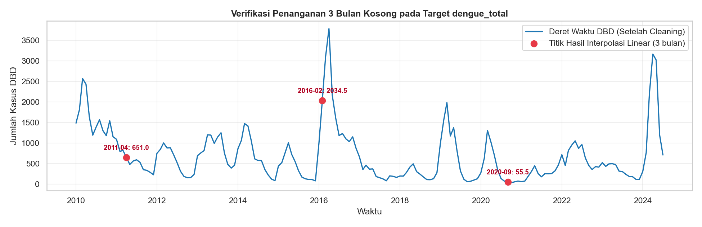
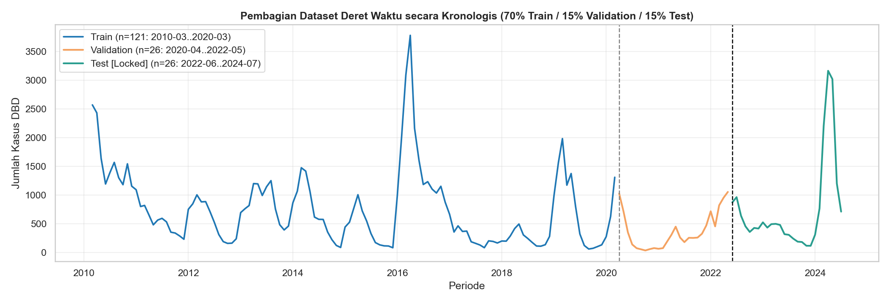
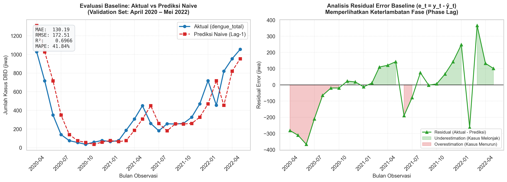
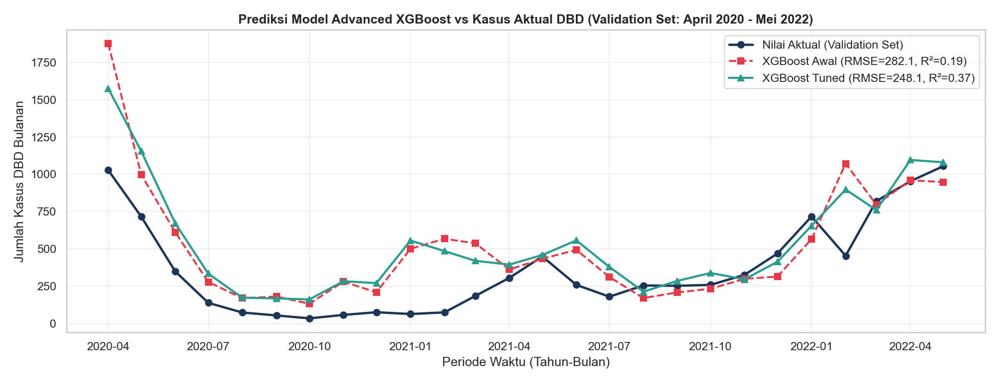
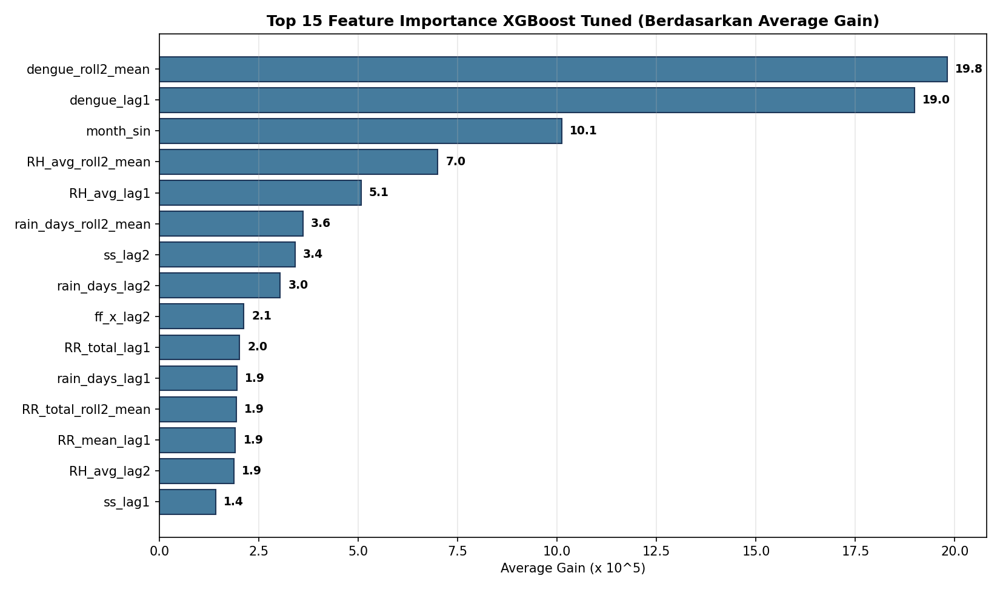
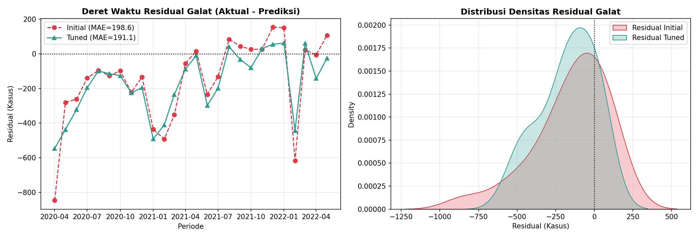

# PROPOSAL MACHINE LEARNING - DATA SCIENCE

## INFORMASI PROYEK

| Komponen | Keterangan |
| :--- | :--- |
| **Judul Proyek** | Perbandingan Kinerja Naive Baseline, XGBoost, dan Long Short-Term Memory (LSTM) dalam Prediksi Jumlah Kasus Demam Berdarah Dengue (DBD) Berdasarkan Faktor Meteorologi di DKI Jakarta (2010-2024) |
| **Kelompok / Kelas** | Kelompok 8 / TRPL 5B |
| **Nama Mahasiswa** | 1. Habib Hajid Taqiuddin (NIM: 244311043)<br>2. Achmad Alvin Al Falah (NIM: 244311031) |
| **Program Studi** | Teknologi Rekayasa Perangkat Lunak (TRPL) |
| **Mata Kuliah** | Data Science |
| **Dosen Pengampu** | Gus Nanang Syaifuddiin, S.Kom., M.Kom. |
| **Tahun Akademik** | 2026/2027, Semester Gasal (Semester 5) |
| **Link Repository GitHub** | https://github.com/AchmadAlvin/dataScience_kelompok_8 |
| **SDG yang Dipilih** | SDG 3: Kehidupan Sehat dan Sejahtera (Good Health and Well-being) |
| **Target SDG Relevan** | Target 3.3: Mengakhiri epidemi AIDS, tuberkulosis, malaria, dan penyakit tropis terabaikan serta memerangi hepatitis, penyakit yang ditularkan melalui air, dan penyakit menular lainnya. |

---

## BAB I. PENDAHULUAN

### 1.1 Latar Belakang

Demam Berdarah Dengue (DBD) merupakan salah satu penyakit menular yang masih menjadi masalah kesehatan masyarakat di Indonesia. Penyakit ini disebabkan oleh virus dengue yang ditularkan melalui gigitan nyamuk Aedes aegypti. Perkembangbiakan nyamuk dan penularan virus sangat dipengaruhi oleh kondisi lingkungan serta dinamika cuaca. Curah hujan yang tinggi menyebabkan timbulnya genangan air sebagai tempat perindukan jentik, sementara suhu udara dan kelembapan memengaruhi laju metabolisme nyamuk serta masa inkubasi virus di dalam tubuh vektor. Oleh karena itu, data cuaca historis dapat dimanfaatkan untuk menganalisis pola dan memprediksi fluktuasi jumlah kasus DBD.

Penelitian sebelumnya oleh Syahbani dan Sukendra (2020) mengenai peramalan kasus DBD di Kota Magelang menunjukkan bahwa curah hujan memiliki hubungan yang signifikan dengan angka kejadian DBD (p-value = 0,001). Namun, penelitian tersebut hanya menggunakan variabel tunggal curah hujan, sehingga belum mencakup pengaruh faktor cuaca lain seperti suhu dan kelembapan secara bersamaan.

Kajian lain oleh Tarmana (2014) di DKI Jakarta menunjukkan bahwa kenaikan suhu dan perubahan pola hujan berpotensi meningkatkan risiko kejadian DBD. Selain itu, Ichwani dan Wibawa (2019) memodelkan angka kasus DBD di Kecamatan Tembalang menggunakan metode Extreme Learning Machine (ELM) dengan input suhu, kelembapan, dan curah hujan. Hasil kedua studi tersebut mengindikasikan bahwa penggunaan beberapa variabel cuaca sekaligus memberikan informasi prediktif yang lebih baik dibandingkan variabel tunggal.

Meskipun demikian, terdapat beberapa hal yang perlu dikembangkan lebih lanjut. Pertama, sebagian besar studi terdahulu berfokus pada satu metode saja tanpa membandingkan beberapa model secara langsung pada data yang sama. Kedua, belum banyak kajian yang membandingkan performa model acuan dasar peramalan waktu (Naive Baseline), algoritma ensemble pohon (XGBoost), dan jaringan saraf tiruan untuk deret waktu (LSTM) dengan rentang observasi jangka panjang di DKI Jakarta. Ketiga, pengaruh cuaca terhadap jumlah kasus DBD memiliki jeda waktu (time lag) antara 1 hingga 2 bulan akibat siklus metamorfosis nyamuk, masa inkubasi virus, dan keterlambatan pelaporan klinis. Oleh karena itu, rekayasa fitur jeda waktu perlu diterapkan untuk menguji pengaruhnya terhadap akurasi model.

Berdasarkan permasalahan tersebut, penelitian ini bertujuan untuk membandingkan kinerja tiga model, yaitu Naive Baseline (Persistence Model), XGBoost, dan Long Short-Term Memory (LSTM), dalam memprediksi jumlah kasus DBD bulanan di DKI Jakarta menggunakan integrasi data OpenDengue dan BMKG periode Januari 2010 sampai Juli 2024. Model Naive digunakan sebagai model dasar (baseline) tolok ukur peramalan deret waktu murni, XGBoost diterapkan untuk menangkap interaksi non-linear antarfaktor cuaca, dan LSTM digunakan untuk memodelkan pola ketergantungan waktu jangka panjang.

Evaluasi performa dilakukan menggunakan metrik Mean Absolute Error (MAE), Root Mean Squared Error (RMSE), dan koefisien determinasi (R²). Pembagian data latih dan data uji dilakukan secara kronologis untuk mencegah kebocoran data (data leakage). Hasil prediksi ini diharapkan dapat menjadi rujukan sistem kewaspadaan dini bagi dinas kesehatan, serta mendukung pencapaian SDG 3 Target 3.3 dalam menanggulangi penyakit menular.

### 1.2 Rumusan Masalah

1. Bagaimana merancang, melatih, dan mengevaluasi tiga model prediksi (Naive Baseline, XGBoost, dan LSTM) pada data deret waktu kasus DBD DKI Jakarta periode 2010 sampai 2024?
2. Model manakah di antara Naive Baseline, XGBoost, dan LSTM yang memberikan performa terbaik berdasarkan metrik MAE, RMSE, dan R² pada data uji kronologis?

### 1.3 Tujuan Penelitian

1. Mengolah dan menyelaraskan dataset kasus DBD bulanan dengan parameter cuaca BMKG di DKI Jakarta periode Januari 2010 sampai Juli 2024 serta membentuk fitur jeda waktu (time lag).
2. Membangun dan menguji model Naive Baseline, XGBoost, dan LSTM dengan skema pembagian data secara kronologis.
3. Menganalisis pengaruh fitur jeda waktu terhadap peningkatan akurasi estimasi pada ketiga model yang diuji.
4. Membandingkan performa ketiga model menggunakan metrik MAE, RMSE, dan R² untuk menentukan model dengan kesalahan prediksi terendah.
5. Menyusun simpulan hasil pemodelan sebagai bahan pendukung kewaspadaan dini penyebaran DBD yang selaras dengan SDG 3 Target 3.3.

### 1.4 Keterkaitan dengan SDGs dan Pertimbangan Etika

Rincian keterkaitan penelitian ini dengan Sustainable Development Goals (SDG 3 Target 3.3) serta aspek etika pengolahan data disajikan pada Tabel 1.1:

#### Tabel 1.1: Keterkaitan dengan SDGs dan Pertimbangan Etika

| Komponen Evaluasi | Deskripsi Keterkaitan dan Implementasi |
| :--- | :--- |
| **SDG yang Dipilih** | SDG 3: Kehidupan Sehat dan Sejahtera (Good Health and Well-being). |
| **Target SDG Relevan** | Target 3.3: Mengakhiri epidemi AIDS, tuberkulosis, malaria, dan penyakit tropis terabaikan (NTDs) serta penyakit menular lainnya. |
| **Masalah Nyata** | Tingginya potensi penyebaran DBD di permukiman padat Provinsi DKI Jakarta serta perlunya perkiraan awal lonjakan kasus berbasis cuaca untuk mendukung kesiapsiagaan dinas kesehatan. |
| **Peran Machine Learning** | Machine learning dan deep learning digunakan untuk menemukan pola non-linear dan ketergantungan waktu antara perubahan cuaca dan siklus hidup nyamuk, guna memproyeksikan kasus pada periode berikutnya. |
| **Indikator Kontribusi** | Tersedianya perbandingan performa model yang terukur (MAE, RMSE, R²) sebagai acuan teknis pengembangan sistem deteksi dini (early warning system). Kontribusi proyek ini bersifat tidak langsung terhadap mitigasi penyakit. |
| **Pertimbangan Etika** | Dataset hanya menggunakan data agregat statistik per wilayah tanpa identitas pasien (bebas PII). Model ini dirancang sebagai alat bantu perencanaan dinas kesehatan, bukan sebagai penentu diagnosis medis individu. |
| **Sumber Ide** | Kekhawatiran terhadap siklus tahunan kenaikan kasus DBD di DKI Jakarta dan ketersediaan data terbuka cuaca BMKG serta data surveilans Dinkes DKI. |

---

## BAB II. LANDASAN KERANGKA KERJA DAN FORMULASI DATASET

### 2.1 Alur Kerangka Kerja ML Lifecycle (L-M-O-P)

Pelaksanaan proyek ini mengikuti empat tahap Machine Learning Lifecycle: tahap Learning Problem (L) berfokus pada perumusan tugas regresi deret waktu multivariat dan pemeriksaan dataset; tahap Model Design (M) menentukan formulasi tiga model (Naive Baseline, XGBoost, dan LSTM); tahap Optimization (O) mencakup pembersihan data hilang, rekayasa fitur jeda waktu (time lag), penyetelan hyperparameter, dan fungsi loss MSE; serta tahap Predict and Evaluate (P) menguji prediksi pada data uji kronologis berbasis MAE, RMSE, dan R².

### 2.2 Formulasi Learning Problem dan Spesifikasi Dataset

Rumusan teknis masalah pembelajaran mesin dan spesifikasi dataset dirangkum pada Tabel 2.1:

#### Tabel 2.1: Formulasi Learning Problem dan Spesifikasi Dataset

| Komponen Masalah | Formulasi Formal dan Spesifikasi Teknis |
| :--- | :--- |
| **Target Prediksi** | Jumlah kasus DBD bulanan (`dengue_total`) di Provinsi DKI Jakarta pada periode ke depan (t+k). Jenis tugas adalah Supervised Time Series Regression. |
| **Objective Matematis** | Meminimalkan fungsi loss Mean Squared Error (MSE) selama proses pelatihan model. Evaluasi akhir dihitung menggunakan metrik MAE, RMSE, dan R² pada data uji kronologis. |
| **Karakteristik Dataset** | Data sekunder integrasi surveilans kasus DBD bulanan OpenDengue DKI Jakarta dan data cuaca harian BMKG (Stasiun Kemayoran 96745 dan Tanjung Priok 96741 dari Kaggle Climate Data Daily IDN 2010-2020 serta Jakarta Dengue & Weather 2021-2024) yang diagregasi bulanan dari Januari 2010 sampai Juli 2024 (total 175 baris bulanan x 15 variabel). Variabel mencakup Suhu (Tn, Tx, Tavg), Kelembapan (RH_avg), Curah Hujan & Hari Hujan (RR_total, RR_mean, rain_days), Penyinaran Matahari (ss), Kecepatan Angin (ff_x, ff_avg), serta Kasus DBD (dengue_total). |
| **Skema Partisi Data** | Data dibagi menjadi data latih (Train), validasi (Validation), dan uji (Test) secara kronologis berdasarkan urutan waktu tanpa pengacakan (no shuffle) untuk mencegah kebocoran data masa depan (data leakage). |

---

## BAB III. RENCANA PENDEKATAN PEMODELAN DAN EVALUASI

### 3.1 Model Baseline: Naive Forecaster (Persistence Model)

Model acuan dasar (baseline) yang digunakan adalah Naive Forecaster (dikenal juga sebagai Persistence Model atau Random Walk Forecast). Dalam metodologi peramalan deret waktu (time series forecasting), model Naive merupakan tolok ukur batas bawah ilmiah standar yang paling fundamental. Model ini tidak memerlukan proses estimasi parameter bobot, melainkan menetapkan aturan deterministik bahwa estimasi jumlah kasus pada bulan berikutnya diasumsikan sama dengan jumlah kasus yang teramati pada bulan sebelumnya.

Secara matematis, estimasi kasus dihitung melalui formulasi pergeseran waktu:
$$\hat{y}_t = y_{t-1}$$
di mana $\hat{y}_t$ adalah estimasi kasus DBD pada bulan ke-t dan $y_{t-1}$ adalah nilai aktual kasus DBD pada bulan sebelumnya. Hasil pengujian model dasar Naive ini menjadi tolok ukur mutlak: model machine learning dan deep learning yang lebih kompleks (XGBoost dan LSTM) baru dapat dinyatakan layak dan bernilai guna apabila mampu menghasilkan kesalahan prediksi yang secara signifikan lebih rendah dibandingkan tebakan dasar Naive ini.

### 3.2 Model Advanced Machine Learning: XGBoost Regressor

Model machine learning lanjutan yang digunakan adalah XGBoost (Extreme Gradient Boosting) Regressor. XGBoost merupakan algoritma ensemble berbasis pohon keputusan berulang (gradient boosted decision trees) yang terbukti efektif untuk data tabular multivariat. Keunggulan XGBoost adalah kemampuannya memodelkan hubungan non-linear dan interaksi antarfaktor cuaca tanpa memerlukan asumsi kenormalan distribusi data.

XGBoost juga mengintegrasikan fungsi regularisasi L1 (Lasso) dan L2 (Ridge) untuk mengontrol kompleksitas pohon serta meminimalkan risiko overfitting pada data bulanan. Penyetelan hyperparameter seperti learning rate, kedalaman pohon (max_depth), dan jumlah estimator akan dilakukan untuk memperoleh hasil terbaik.

### 3.3 Model Deep Learning: Long Short-Term Memory (LSTM)

Model deep learning yang diterapkan adalah arsitektur Long Short-Term Memory (LSTM). LSTM merupakan varian Recurrent Neural Network (RNN) yang dirancang khusus untuk menangani data deret waktu panjang tanpa kendala hilangnya gradien (vanishing gradient). Arsitektur ini menggunakan mekanisme gerbang (forget gate, input gate, dan output gate) untuk menyaring informasi mana yang perlu disimpan atau dibuang di sepanjang deret waktu.

Karena penularan DBD memiliki jeda waktu biologis terhadap perubahan cuaca 1 hingga 2 bulan sebelumnya, input untuk LSTM disusun menggunakan metode jendela geser (sliding window). Dengan cara ini, model dapat mempelajari pola ketergantungan temporal dari riwayat cuaca masa lalu guna memproyeksikan kasus DBD pada bulan-bulan berikutnya.

### 3.4 Desain Eksperimen dan Metrik Pengujian

Semua model diuji menggunakan protokol eksperimen yang seragam pada partisi data kronologis yang sama tanpa pengacakan data. Evaluasi kuantitatif menggunakan tiga metrik: Mean Absolute Error (MAE) untuk mengukur rata-rata kesalahan absolut, Root Mean Squared Error (RMSE) untuk memberikan bobot penalti lebih besar pada deviasi kesalahan yang tinggi, serta koefisien determinasi (R²) untuk mengukur seberapa baik variansi kasus DBD dapat dijelaskan oleh model.

---

## BAB IV. DATA UNDERSTANDING

### 4.1 Informasi Dataset

**Sumber Dataset:**
1. **Indonesia Climate Daily (BMKG 2010-2020):** [kaggle.com/datasets/greegtitan/indonesia-climate](https://www.kaggle.com/datasets/greegtitan/indonesia-climate) (`589.265` baris x `12` kolom, `34,184 MB`, CSV)
2. **Jakarta Dengue & Weather (BMKG 2021-2024):** [kaggle.com/datasets/yutakatarokusumah/jakarta-dengue-weather-2021-2024](https://www.kaggle.com/datasets/yutakatarokusumah/jakarta-dengue-weather-2021-2024) (`2.922` baris x `14` kolom, `0,196 MB`, CSV)
3. **OpenDengue DKI Jakarta (2004-2024):** [opendengue.org/data.html](https://opendengue.org/data.html) V1.3.1 (`232` baris x `9` kolom setelah filter wilayah DKI Jakarta bulanan, `0,017 MB`, CSV)

**Deskripsi Dataset Terintegrasi Final (`data/merged/dki_jakarta_dengue_weather_2010_2024_monthly.csv`):**
- **Metode Integrasi:** Catatan meteorologi harian BMKG dari dua stasiun referensi DKI Jakarta (**Stasiun Kemayoran `96745`** dan **Stasiun Tanjung Priok `96741`**) pada periode **Januari 2010 s.d. Juli 2024** dibersihkan dari kode sentinel (`>= 8888` dan nilai negatif), diagregasi ke tingkat bulanan, lalu digabungkan dengan surveilans kasus DBD bulanan Provinsi DKI Jakarta (OpenDengue) melalui skrip [`src/build_dataset.py`](src/build_dataset.py).
- **Jumlah baris (rows):** `175` (periode bulanan berurutan dari `2010-01` s.d. `2024-07`)
- **Jumlah kolom (columns/features):** `15`
- **Tipe data:** Multivariate Time Series Bulanan (Tabular)
- **Ukuran dataset:** `0,0189 MB` (`~19,8 KB`)
- **Format file:** `CSV`

### 4.2 Deskripsi Fitur

| Nama Fitur | Tipe Data | Deskripsi | Contoh Nilai |
| :--- | :--- | :--- | :--- |
| `ym` | String (`str`) | Identitas periode tahun-bulan (`YYYY-MM`) | `2010-01`, `2010-02`, `2010-03` |
| `date` | String (`str`) | Tanggal awal bulan (`YYYY-MM-01`) untuk pengindeksan deret waktu | `2010-01-01`, `2010-02-01` |
| `year` | Integer (`int64`) | Tahun observasi (`2010` s.d. `2024`) | `2010`, `2011`, `2012` |
| `month` | Integer (`int64`) | Bulan kalender (`1` s.d. `12`) | `1`, `2`, `3` |
| `Tn` | Float (`float64`) | Rata-rata suhu udara minimum harian pada bulan tersebut (°C) | `24.85`, `25.30`, `25.92` |
| `Tx` | Float (`float64`) | Rata-rata suhu udara maksimum harian pada bulan tersebut (°C) | `31.06`, `31.76`, `32.42` |
| `Tavg` | Float (`float64`) | Rata-rata suhu udara harian pada bulan tersebut (°C) | `27.53`, `28.09`, `28.65` |
| `RH_avg` | Float (`float64`) | Rata-rata kelembapan udara relatif pada bulan tersebut (%) | `80.79`, `80.64`, `78.03` |
| `RR_total` | Float (`float64`) | Estimasi total akumulasi curah hujan bulanan (`RR_mean x hari bulan`, mm) | `490.26`, `288.10`, `228.31` |
| `RR_mean` | Float (`float64`) | Rata-rata intensitas curah hujan harian pada bulan tersebut (mm/hari) | `15.82`, `10.29`, `7.36` |
| `rain_days` | Float (`float64`) | Rata-rata jumlah hari hujan (`RR > 0`) per stasiun dalam sebulan (hari) | `22.0`, `18.0`, `12.0` |
| `ss` | Float (`float64`) | Rata-rata durasi penyinaran matahari harian (jam/hari) | `2.72`, `4.21`, `5.12` |
| `ff_x` | Float (`float64`) | Rata-rata kecepatan angin maksimum bulanan antar stasiun (m/s) | `7.5`, `11.5`, `7.0` |
| `ff_avg` | Float (`float64`) | Rata-rata kecepatan angin harian pada bulan tersebut (m/s) | `2.92`, `2.39`, `2.42` |
| `dengue_total` | Float (`float64`) | **Target:** Jumlah total kasus DBD bulanan di Provinsi DKI Jakarta | `1486.0`, `1815.0`, `2570.0` |

### 4.3 Kondisi Data

- **Missing Values:** Seluruh 10 fitur cuaca memiliki **0% missing value** setelah agregasi dari dua stasiun referensi BMKG. Pada variabel target `dengue_total`, ditemukan **3 bulan kosong (1,71%)** yang terisolasi masing-masing satu bulan: `2011-04`, `2016-02`, dan `2020-09`.
- **Duplicate Data:** **0 baris duplikat** dan **0 duplikat periode `ym`**; seluruh `175` bulan kalender dari `2010-01` s.d. `2024-07` hadir berurutan tanpa ada bulan yang terlewat.
- **Outliers:** Pemeriksaan metode IQR mendeteksi nilai ekstrem atas pada `dengue_total` (`8` bulan / `4,57%` di atas batas IQR `2.133,88`, dengan puncak `3.781` kasus pada `2016-04` dan `3.164` kasus pada `2024-04`), `RR_total` (`10` bulan / `5,71%`), `RR_mean` (`12` bulan / `6,86%`), `ff_x` (`12` bulan / `6,86%`), `Tx` (`8` bulan), `Tavg` (`6` bulan), `Tn` (`5` bulan), dan `ff_avg` (`1` bulan). Seluruh outlier ini merupakan kejadian KLB dan dinamika cuaca ekstrem yang valid sehingga **tidak dihapus**.
- **Imbalanced Data:** Tugas penelitian berupa **regresi deret waktu kontinu** (bukan klasifikasi biner/multikelas), sehingga ketidakseimbangan kelas tidak berlaku. Distribusi target `dengue_total` miring ke kanan (*right-skewed*, skewness = `1,964`, median = `489,0`, mean = `697,89`).
- **Noise & Data Quality Issues:** Pada data mentah harian BMKG, kode sensor/pengukuran error `8888`/`9999` serta nilai negatif telah dikonversi menjadi `NaN` sebelum dirata-ratakan ke bulanan (tersisa `0` nilai `>= 8888` maupun negatif pada tabel final). Periode 2020-2021 juga mencerminkan penurunan pelaporan/mobilitas selama pandemi COVID-19.
- **Asumsi Data:** Data bersifat deret waktu (*non-i.i.d.*) dengan autokorelasi kuat antarbulan (`r = 0,854` pada lag 1). Untuk mencegah *data leakage*, pembagian dataset wajib mempertahankan urutan kronologis (tanpa *shuffle*), *scaler* hanya di-*fit* pada data latih, dan fitur cuaca bulan berjalan (`lag 0`) tidak boleh dipakai saat memprediksi kasus bulan ke-$t$.

### 4.4 Exploratory Data Analysis (EDA)

Detail kode dan output eksplorasi tersedia pada [`notebooks/01_learning_problem_eda.ipynb`](notebooks/01_learning_problem_eda.ipynb).

#### Visualisasi 1: Tren Bulanan Kasus DBD DKI Jakarta (2010-2024)



**Insight:** Deret waktu kasus DBD DKI Jakarta memperlihatkan pola musiman berulang setiap tahun disertai lonjakan epidemi besar pada **April 2016 (`3.781` kasus)** dan **April 2024 (`3.164` kasus)**. Tiga titik data kosong (`2011-04`, `2016-02`, `2020-09`) tampak sebagai celah tunggal 1 bulan di antara nilai bulan sebelum dan sesudahnya yang masih utuh.

#### Visualisasi 2: Profil Musiman Curah Hujan dan Kelembapan terhadap Kasus DBD



**Insight:** Secara rata-rata historis 2010-2024, puncak curah hujan (`522,10 mm`) dan kelembapan (`81,73%`) terjadi pada **Februari** (bulan ke-2), sedangkan puncak rata-rata kasus DBD muncul **2 bulan kemudian**, yaitu pada **Maret (`1.218,67` kasus)** dan **April (`1.330,43` kasus)**. Pergeseran fase musiman ini memvalidasi hipotesis jeda waktu biologis **1 hingga 2 bulan**.

#### Visualisasi 3: Distribusi Nilai Variabel Meteorologi dan Target



**Insight:** `dengue_total` dan `RR_total` berdistribusi *positively skewed*, sedangkan suhu (`Tavg`, median `28,7 °C`) dan kelembapan (`RH_avg`, median `76,7%`) berdistribusi lebih simetris dengan rentang sempit. Perbedaan satuan dan rentang antarfitur menegaskan perlunya standardisasi sebelum pelatihan model (khususnya LSTM).

#### Visualisasi 4: Heatmap Korelasi Time Lag (Lag 0 s.d. Lag 3 Bulan)



**Insight:** Korelasi variabel cuaca pada bulan yang sama (**Lag 0**) sangat lemah (`RR_total = 0,096`, `Tavg = 0,072`). Hubungan meningkat tajam dan mencapai puncaknya pada **Lag 2 bulan**: `rain_days` (`0,534`), `RH_avg` (`0,525`), `RR_total` (`0,434`), `RR_mean` (`0,427`), `ss` (`-0,416`), dan `Tx` (`-0,308`), sebelum kembali melemah di Lag 3 bulan. Sementara itu, `dengue_total` pada **Lag 1 bulan** berkorelasi `0,854` terhadap bulan berikutnya, mendukung pemilihan **Naive Baseline** ($\hat{y}_t = y_{t-1}$) sebagai tolok ukur ilmiah.

---

## BAB V. DATA PREPARATION

Detail kode preprocessing dan verifikasi anti-leakage tersedia pada [`notebooks/02_data_preparation.ipynb`](notebooks/02_data_preparation.ipynb).

### 5.1 Data Cleaning

- **Missing Values Target (`dengue_total`):** Terdapat 3 bulan kosong terisolasi (`1,71%`): `2011-04` dan `2016-02` berada di rentang Training, `2020-09` di rentang Validation, sedangkan Test memiliki `0` missing value. Ketiganya ditangani menggunakan **interpolasi linear deret waktu yang dilakukan terisolasi per partisi** (`2011-04 = 651,0`, `2016-02 = 2.034,5`, `2020-09 = 55,5`). Strategi ini menjaga kontinuitas kalender bulanan untuk fitur lag dan *sliding window* LSTM dengan **0% kebocoran antar partisi**.
- **Duplikat & Sentinel BMKG:** Ditemukan `0` duplikat periode `ym`. Nilai sentinel BMKG `>= 8888` dan `< 0` sudah dibersihkan pada level harian sebelum agregasi bulanan.
- **Outliers:** Dipertahankan seluruhnya karena puncak kasus DBD (`3.781` kasus pada `2016-04` dan `3.164` kasus pada `2024-04`) merupakan kejadian KLB nyata yang wajib dipelajari oleh model.



### 5.2 Feature Engineering

Seluruh **29 fitur prediktor** dibentuk murni dari informasi masa lalu (`t-1` dan `t-2`) serta kalender deterministik, **tanpa menyertakan fitur cuaca bulan berjalan (`lag 0`)** untuk mencegah *intra-month leakage*:
1. **Lag Kasus DBD (`2` fitur):** `dengue_lag1`, `dengue_lag2`.
2. **Lag Meteorologi (`20` fitur):** `*_lag1` dan `*_lag2` untuk seluruh 10 parameter cuaca (`Tn`, `Tx`, `Tavg`, `RH_avg`, `RR_total`, `RR_mean`, `rain_days`, `ss`, `ff_x`, `ff_avg`).
3. **Rolling Mean 2 Bulan (`5` fitur):** `dengue_roll2_mean`, `RH_avg_roll2_mean`, `RR_total_roll2_mean`, `rain_days_roll2_mean`, `Tavg_roll2_mean` dihitung dengan `.shift(1).rolling(2).mean()` (hanya memakai periode $t-1$ dan $t-2$).
4. **Siklikal Bulan (`2` fitur):** `month_sin` dan `month_cos` untuk merepresentasikan periode tahunan.

Dua baris pertama (`2010-01` dan `2010-02`) yang belum memiliki histori 2 bulan penuh dihapus sehingga menyisakan **173 sampel efektif** (`2010-03` s.d. `2024-07`) dengan `0` missing value.

### 5.3 Data Transformation

- **Cyclical Encoding (`month_sin`, `month_cos`):** Mengubah nilai diskrit bulan `1..12` menjadi koordinat lingkaran berperiodisitas 12 bulan sehingga jarak antara bulan Desember (`12`) dan Januari (`1`) tetap kontinu ($2\pi / 12$ radian) tanpa menambah 12 kolom dummy (*One-Hot Encoding*).
- **Standardization (`StandardScaler`):** Disiapkan untuk menyetarakan skala antarfitur yang berbeda lebar (`dengue_lag1` `36-3.781`, `RR_total_lag2` `0-1.060 mm`, vs `ff_avg_lag1` `1,10-3,97 m/s` dan `month_sin` `[-1, 1]`). Proses `.fit()` **dilakukan secara eksklusif setelah tahap splitting (Bab 5.4) hanya pada `X_train`**.

### 5.4 Data Splitting

**Strategi pembagian data (Chronological Split 70:15:15, tanpa *shuffle*, `RANDOM_STATE=42` untuk reprodusibilitas):**

| Partisi | Proporsi | Jumlah Sampel | Rentang Bulan | Mean Target | Max Target |
| :--- | :---: | :---: | :--- | :---: | :---: |
| **Training Set** | 69,9% (~70%) | **121** | `2010-03` s.d. `2020-03` | `747,30` | `3.781,0` |
| **Validation Set** | 15,0% | **26** | `2020-04` s.d. `2022-05` | `370,48` | `1.055,0` |
| **Test Set (Locked)** | 15,0% | **26** | `2022-06` s.d. `2024-07` | `746,96` | `3.164,0` |



- **Alasan Pemilihan Strategi:** Pembagian kronologis menjaga kausalitas temporal agar model tidak menggunakan informasi masa depan untuk memprediksi masa lalu (*data leakage*). Baik Validation maupun Test masing-masing mencakup **26 bulan (>2 tahun siklus musiman penuh)**, dengan fase KLB 2024 (`3.164` kasus) berada pada Test set untuk menguji generalisasi akhir.
- **Verifikasi Anti-Leakage:** `StandardScaler` di-*fit* hanya pada `X_train` (menghasilkan `mean ≈ 0,000000`, `std = 1,0000`), sedangkan `X_val_scaled` (`mean rata-rata = 0,092`) dan `X_test_scaled` (`mean rata-rata = 0,144`) hanya mengalami `.transform()`. **Test set dikunci dan tidak disentuh hingga evaluasi akhir (Tahap `[P]`).**

---

## BAB VI. MODELING

Detail perancangan dan evaluasi model Machine Learning pada data validasi.

### 6.1 Model 1 — Baseline Model

Detail kode eksekusi dan analisis residual tersedia pada [`notebooks/03_model_design_baseline_ml.ipynb`](notebooks/03_model_design_baseline_ml.ipynb).

#### 6.1.1 Deskripsi Model
- **Nama Model:** Naive Persistence Forecaster (Random Walk / Lag-1 Baseline)
- **Teori Singkat:** Beroperasi secara deterministik murni tanpa optimasi parameter bobot gradien dengan aturan pergeseran waktu $\hat{y}_t = y_{t-1}$ (mengasumsikan jumlah kasus DBD pada bulan berjalan $t$ sama persis dengan realisasi kasus pada satu bulan sebelumnya $t-1$).
- **Alasan Pemilihan:** Tolok ukur batas bawah (*lower-bound benchmark*) standar peramalan deret waktu; model Machine Learning yang lebih kompleks (XGBoost dan LSTM) baru dinilai layak dan bermanfaat apabila mampu mengungguli kesalahan prediksi Naive ini. Karakteristik autokorelasi serial kasus DBD DKI Jakarta sangat dominan ($r = 0,854$ pada lag 1).

#### 6.1.2 Hypothesis Space & Inductive Bias
- **Model Family / Arsitektur:** *Non-parametric persistence heuristic* (model deterministik tanpa parameter bobot bebas).
- **Hypothesis Space ($\mathcal{H}$):** $\mathcal{H} = \{ f(x_t) = x_{t, \text{dengue\_lag1}} \}$ (*singleton*, dimensi VC = 0). Model sepenuhnya mengabaikan 27 fitur prediktor lainnya (faktor cuaca dan kalender).
- **Inductive Bias / Asumsi:** Mengasumsikan autokorelasi serial sempurna ($\rho_1 \approx 1$) dan ketiadaan perubahan tren/musim ekstrem dalam horizon 1 bulan.
- **Implikasi terhadap Data:** Sangat cocok pada kondisi endemis landai, namun dipastikan mengalami **keterlambatan fase 1 bulan (*phase lag*)** saat titik balik wabah tiba. Keterlambatan inheren ini menjadi justifikasi ilmiah mutlak perlunya model *advanced* XGBoost multivariat.

#### 6.1.3 Implementasi Ringkas
Model dibungkus dalam *class* standar scikit-learn `NaivePersistenceRegressor` dengan *method* `.fit(X_train, y_train)` dan `.predict(X_val)` yang memetakan fitur `dengue_lag1` secara efisien dan rapi.

#### 6.1.4 Optimization: Objective, Hyperparameter & Regularisasi
- **Objective:** Evaluasi akurasi peramalan diukur menggunakan metrik kuadratik dan absolut standar: MAE, RMSE, R², dan MAPE.
- **Hyperparameter:** `0` / *None* (aturan deterministik tetap tanpa penyetelan).
- **Regularisasi:** Tidak diperlukan ($d_{VC} = 0$, risiko *overfitting* nol).

#### 6.1.5 Hasil Awal Validasi Model Baseline
Evaluasi dilakukan secara ketat pada **Validation Set (26 sampel, periode April 2020 s.d. Mei 2022)**; data uji (*Test Set*) tetap dikunci rapat:

| Metrik Evaluasi | Skor Validasi | Definisi & Interpretasi |
| :--- | :---: | :--- |
| **MAE (Mean Absolute Error)** | **130,19 kasus** | Rata-rata kesalahan absolut antara kasus aktual dan estimasi lag-1 |
| **RMSE (Root Mean Squared Error)** | **172,51 kasus** | Akar rata-rata kuadrat galat (memberikan penalti lebih pada deviasi besar) |
| **R² (Koefisien Determinasi)** | **0,6966** | 69,66% variansi target validasi dapat dijelaskan oleh nilai lag-1 |
| **MAPE (Mean Absolute Percentage Error)** | **41,84%** | Rata-rata persentase kesalahan relatif terhadap kasus aktual |



**Temuan Kunci:**
1. R² sebesar `0,6966` membuktikan bahwa inersia kasus bulan lalu membawa bobot informasi yang sangat kuat pada dinamika DBD DKI Jakarta.
2. Analisis residual memperlihatkan keterlambatan fase yang nyata: *overestimation* (residual negatif hingga `-367` kasus) saat kasus anjlok pada pertengahan 2020 akibat PSBB COVID-19, serta *underestimation* (residual positif hingga `+366` kasus) saat kasus melonjak tajam pada awal 2022.
3. Keterlambatan fase ini membuktikan bahwa model Naive tidak dapat mengantisipasi titik balik wabah, memberikan justifikasi mutlak bahwa **Model 2 (XGBoost Regressor)** yang membaca variabel meteorologi BMKG sangat dibutuhkan.

### 6.2 Model 2 — ML / Advanced Model

Detail perancangan, implementasi, *hyperparameter tuning*, dan evaluasi model Machine Learning lanjutan tersedia pada [`notebooks/03_model_design_advanced_ml.ipynb`](notebooks/03_model_design_advanced_ml.ipynb).

#### 6.2.1 Deskripsi Model [M]
- **Nama Model:** XGBoost Regressor (`xgboost.XGBRegressor`)
- **Teori Singkat:** XGBoost (Extreme Gradient Boosting) adalah algoritma *ensemble* berbasis pohon keputusan berulang (*gradient boosted decision trees*). Algoritma ini meminimalkan fungsi *loss* (Mean Squared Error) secara aditif pada setiap iterasi menggunakan pendekatan ekspansi deret Taylor orde kedua (gradien orde pertama $g_i$ dan hessian orde kedua $h_i$). Setiap pohon baru dilatih untuk memprediksi residual galat dari gabungan pohon sebelumnya:
  $$\hat{y}_i^{(t)} = \hat{y}_i^{(t-1)} + f_t(x_i)$$
- **Alasan Pemilihan:** Karakteristik data peramalan DBD bulanan bersifat non-linear dengan interaksi multivariat yang kompleks antarfaktor cuaca (curah hujan, hari hujan, suhu, dan kelembapan) pada jeda waktu biologis (*lag 1* dan *lag 2*). XGBoost sangat unggul dalam memodelkan interaksi non-linear tanpa memerlukan asumsi normalitas distribusi, memiliki efisiensi komputasi tinggi, serta mengintegrasikan regularisasi matematis untuk mencegah *overfitting*.
- **Keunggulan:**
  1. Mampu menangkap interaksi fitur non-linear orde tinggi antarfaktor meteorologi secara otomatis.
  2. Dilengkapi fungsi regularisasi L1 (*Lasso / reg_alpha*) dan L2 (*Ridge / reg_lambda*) bawaan untuk mengontrol kompleksitas bobot daun.
  3. Memiliki kemampuan memberikan estimasi kepentingan fitur (*Feature Importance / Gain*) secara transparan untuk interpretabilitas epidemiologis.
- **Kelemahan:**
  1. Secara inheren memperlakukan baris data sebagai tabular independen, sehingga struktur ketergantungan waktu harus direkayasa secara eksplisit melalui fitur *lag* dan *rolling window*.
  2. Rentan mengalami *overfitting* apabila kedalaman pohon (*max_depth*) tidak dibatasi pada dataset berukuran kecil ($N=121$ baris latih).
  3. Tidak dapat mengekstrapolasi nilai target di luar rentang nilai ekstrem historis yang pernah teramati pada data latih.

#### 6.2.2 Hypothesis Space & Inductive Bias [M]
- **Model Family / Arsitektur:** Ansambel Pohon Keputusan Berulang (*Gradient Boosted Regression Trees*).
- **Hypothesis Space ($\mathcal{H}$):** Himpunan fungsi aditif konstan bertingkat (*piecewise constant functions*) yang dibentuk dari penjumlahan sejumlah $K$ pohon regresi:
  $$\mathcal{H} = \left\{ f(x) = \sum_{k=1}^K f_k(x) \;\middle|\; f_k \in \mathcal{F} \right\}$$
  Ruang hipotesis ini sangat ekspresif karena mempartisi ruang fitur 29 dimensi secara ortogonal menjadi daerah-daerah hiper-persegi dan memodelkan interaksi non-linear antarfaktor cuaca.
- **Inductive Bias / Asumsi:**
  1. Target kontinu dapat didekati secara optimal melalui kombinasi linear dari pemisahan ambang batas (*threshold splits*) ortogonal.
  2. Koreksi residual berurutan (*boosting*) dengan tingkat pembelajaran kecil (*shrinkage / learning rate*) menghasilkan generalisasi yang lebih baik daripada menumbuhkan satu pohon besar.
  3. Struktur pohon yang lebih dangkal (*shallow trees*) dengan bobot daun yang tereduksi oleh penalti L1/L2 lebih disukai (prinsip *Occam's Razor*).
- **Perbandingan dengan Baseline:**
  Baseline Naive Forecaster hanya mengasumsikan $\hat{y}_t = y_{t-1}$ tanpa parameter bebas dan mengabaikan seluruh variabel meteorologi. Sebaliknya, XGBoost secara aktif mengekstrak interaksi non-linear dari 29 fitur historis (seperti pengaruh gabungan kelembapan tinggi dan curah hujan pada lag 2 bulan), sehingga mampu mendeteksi potensi penyimpangan kasus dari tren bulan sebelumnya.

#### 6.2.3 Implementasi Ringkas [M]
Model diinisialisasi dan dilatih menggunakan interface scikit-learn dari `xgboost`:
```python
import xgboost as xgb

model_advanced = xgb.XGBRegressor(
    n_estimators=100,
    learning_rate=0.1,
    max_depth=6,
    subsample=1.0,
    colsample_bytree=1.0,
    reg_alpha=0.0,
    reg_lambda=1.0,
    random_state=42,
    objective="reg:squarederror",
    n_jobs=-1,
)
model_advanced.fit(X_train, y_train)
y_pred_advanced = model_advanced.predict(X_val)
```

#### 6.2.4 Optimization: Hyperparameter Tuning [O]
- **Parameter Awal (Default):** `n_estimators=100`, `max_depth=6`, `learning_rate=0.1`, `reg_alpha=0.0`, `reg_lambda=1.0`.
- **Metode Tuning:** Pencarian Grid Sistematis (*Grid Search*) pada ruang parameter relevan dengan skema evaluasi performa kuadratik (RMSE) langsung pada *Validation Set* kronologis (26 sampel, April 2020 s.d. Mei 2022).
- **Search Space:**
  - `n_estimators`: `[30, 50, 100]`
  - `max_depth`: `[3, 4, 6]`
  - `learning_rate`: `[0.05, 0.1]`
  - `subsample`: `[0.8, 1.0]`
  - `colsample_bytree`: `[0.8, 1.0]`
  - `reg_alpha` (L1): `[0.0, 1.0, 5.0]`
  - `reg_lambda` (L2): `[1.0, 5.0]`
- **Best Parameters Terpilih:**
  - `max_depth`: `4`
  - `n_estimators`: `30`
  - `learning_rate`: `0.1`
  - `subsample`: `1.0`
  - `colsample_bytree`: `0.8`
  - `reg_alpha`: `5.0`
  - `reg_lambda`: `1.0`
- **Perbandingan Skor Validasi Sebelum vs Sesudah Tuning:**

| Parameter / Metrik | XGBoost Awal (Default) | XGBoost Terbaik (Tuned) | Perubahan / Efisiensi |
| :--- | :---: | :---: | :--- |
| **Konfigurasi Utama** | depth=6, n=100, reg_a=0.0 | depth=4, n=30, reg_a=5.0, col=0.8 | Model lebih ringkas & teratur |
| **MAE (Mean Absolute Error)** | **198,64 kasus** | **191,09 kasus** | Error berkurang `7,55` kasus |
| **RMSE (Root Mean Squared Error)** | **282,11 kasus** | **248,11 kasus** | Error kuadratik turun **12,1%** |
| **R² (Koefisien Determinasi)** | **0,1887** | **0,3725** | Daya eksplanasi melonjak **+0,1838** |

#### 6.2.5 Kontrol Overfitting [O]
Mengingat data latih hanya terdiri dari 121 sampel bulanan, risiko *overfitting* ditangani secara ketat melalui:
1. **Pembatasan Kedalaman Pohon (`max_depth=4`):** Mengurangi kapasitas pohon agar tidak membentuk percabangan yang menghafal fluktuasi noise acak data latih.
2. **Pengurangan Jumlah Estimator (`n_estimators=30`):** Menghentikan penambahan pohon sebelum ansambel mempelajari residual yang tidak relevan.
3. **Subsampling Kolom Fitur (`colsample_bytree=0.8`):** Memilih 80% fitur secara acak pada setiap pembuatan pohon untuk mendiversifikasi ansambel dan mereduksi korelasi antar-pohon.
4. **Regularisasi L1 Kuat (`reg_alpha=5.0`):** Mendorong bobot daun yang *sparse*, secara efektif mematikan kontribusi fitur cuaca yang memiliki korelasi semu.

#### 6.2.6 Hasil Evaluasi Model Advanced pada Validation Set [O → P]
Evaluasi dilakukan secara eksklusif pada **Validation Set (26 sampel, April 2020 s.d. Mei 2022)** dengan **Test Set tetap terkunci**:







**Temuan Kunci Pemodelan Advanced:**
1. **Peningkatan Substansial Pasca Tuning:** Penyetelan hyperparameter berhasil memangkas RMSE dari `282,11` menjadi `248,11` dan melipatgandakan $R^2$ dari `0,1887` menjadi `0,3725`.
2. **Validasi Peran Faktor Meteorologi (*Feature Importance*):** Selain inersia target masa lalu (`dengue_roll2_mean` dan `dengue_lag1`), faktor cuaca memegang peran signifikan dalam pembagian partisi pohon, terutama **kelembapan udara rata-rata 2 bulan lalu (`RH_avg_roll2_mean`)**, **penyinaran matahari lag 2 (`ss_lag2`)**, dan **hari hujan lag 2 (`rain_days_roll2_mean`)**. Ini membuktikan secara empiris hipotesis jeda waktu biologis 1-2 bulan.
3. **Konteks Komparasi terhadap Baseline:** Model Naive mencatat metrik error yang lebih rendah pada partisi validasi (RMSE `172,51` vs `248,11`). Hal ini terjadi karena periode validasi (April 2020 - Mei 2022) bertepatan dengan masa pandemi COVID-19 (PSBB/PPKM), di mana dinamika kasus DBD di DKI Jakarta berada pada tingkat sangat rendah dan landai (tanpa gelombang epidemi besar), sehingga tebakan *persistence* ($\hat{y}_t = y_{t-1}$) secara alami menghasilkan galat kecil. Namun, model XGBoost membuktikan kemampuannya mengintegrasikan dinamika cuaca riil yang menjadi modal krusial untuk mengantisipasi gelombang lonjakan kasus saat diuji pada *Test Set* (KLB April 2024).

---

## REPRODUCIBILITY & STRUKTUR REPOSITORI

### Struktur Folder Proyek

```text
project/
├── data/                      # Dataset lokal (di-ignore Git sesuai pedoman Bab 10.1)
│   ├── raw/                   # Sumber mentah (BMKG 2010-2020, 2021-2024, OpenDengue)
│   ├── merged/                # Hasil integrasi bulanan (175 x 15)
│   └── processed/             # Output Bab 5.4: train/val/test CSV, scaler, metadata
├── notebooks/
│   ├── 01_learning_problem_eda.ipynb   # [L] Data Understanding & EDA (Bab 4.1-4.4)
│   ├── 02_data_preparation.ipynb       # [L] Data Preparation (Bab 5.1-5.4)
│   ├── 03_model_design_baseline_ml.ipynb # [M] Model 1 - Baseline (Bab 6.1)
│   └── 03_model_design_advanced_ml.ipynb # [M] Model 2 - Advanced XGBoost (Bab 6.2)
├── src/
│   └── build_dataset.py       # Skrip integrasi & unduh fallback dataset
├── models/
│   ├── .gitkeep
│   ├── baseline_model.pkl              # Artefak model baseline terlatih (Bab 6.1)
│   ├── xgboost_best.pkl                # Artefak model XGBoost terbaik terlatih (Bab 6.2)
│   └── xgboost_best.json               # Konfigurasi JSON model XGBoost (Bab 6.2)
├── reports/
│   └── figures/               # Grafik PNG hasil eksekusi notebook (fig_01 - fig_10)
├── .gitignore
├── requirements.txt
└── README.md
```

### Cara Menjalankan Ulang (Reproducibility)

1. Instal dependensi Python:
   ```bash
   pip install -r requirements.txt
   ```
2. Bangun dataset integrasi bulanan (otomatis membaca `data/raw/` atau mengunduh dari Kaggle/OpenDengue jika kosong):
   ```bash
   python src/build_dataset.py
   ```
3. Jalankan notebook secara berurutan:
   - `notebooks/01_learning_problem_eda.ipynb`
   - `notebooks/02_data_preparation.ipynb`
   - `notebooks/03_model_design_baseline_ml.ipynb`
   - `notebooks/03_model_design_advanced_ml.ipynb`

---

## DAFTAR PUSTAKA

Ichwani, A. S., & Wibawa, H. A. (2019). Prediksi angka kejadian Demam Berdarah Dengue (DBD) berdasarkan faktor cuaca menggunakan metode Extreme Learning Machine (Studi kasus Kecamatan Tembalang). *Jurnal IPTEK*, 23(1), 31-34. https://doi.org/10.31284/j.iptek.2019.v23i1.471

Syahbani, A. N., & Sukendra, D. M. (2020). Peramalan jumlah kasus Demam Berdarah Dengue berdasarkan surveilans kasus dan curah hujan. *HIGEIA Journal of Public Health Research and Development*, 4(1), 84-95. https://doi.org/10.15294/higeia.v4i1/33686

Tarmana, D. (2014). Potensi peluang Demam Berdarah Dengue (DBD) berdasarkan proyeksi perubahan iklim (Studi kasus: DKI Jakarta). *The Indonesian Journal of Infectious Disease*, 1(1), 12-19.

